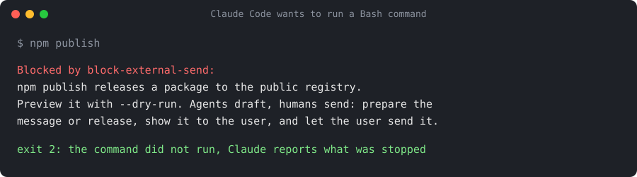
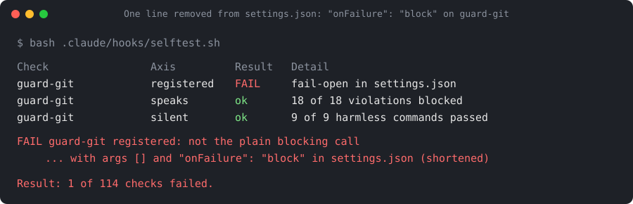

# Your expertise, your AI agents.

Bring me the task that eats your team's week: we check together whether and
how much of it AI can take on, then I build the agreed solution with Claude
Code and hand it over to your team, with documentation and training.

This repository is the safety layer under that work: a Claude Code setup in
which the agent drafts and builds, and people decide, send and release.

**Proof that your guards are wired, fail closed, and catch a broken setup.**
Testing the logic of a hook is common. This starter also proves that each
guard is registered where Claude Code reads it, that it blocks the tool call
when it cannot run, and that the test itself turns red on a broken setup.





*Deutsch: [README.de.md](README.de.md).*


## How Avem works

1. **You bring the task** that costs your team hours every week.
2. **We check together** whether and how much of it AI can take on, and what
   stays with your people.
3. **Fixed price** for the agreed scope.
4. **I build** the solution with Claude Code, on a setup like this one.
5. **Hand-over** to your team, with documentation and training.

Avem Investment GmbH is a Swiss company; this repository belongs to its work
on AI agents for teams.

**See one task from start to hand-over:**
[examples/overdue-invoices](examples/overdue-invoices/) (fictitious client,
real runs: the client's own rules, the build, two reviews by an agent that
cannot edit, the fixes, a customer reply, the hand-over).

## What you get

| | What it does for your team |
|---|---|
| Three guards before every command | Secret values stay off the screen; no force push or history rewrite; nothing is sent, published or deployed by the agent |
| Fail closed, and a protected configuration | A guard that cannot start, crashes with an error, times out or cannot read its input blocks the call instead of letting it through; a settings or skill change that would break the guards is not applied to the running session |
| A selftest with calibration | Proves the guards are registered in the project settings, block what they should and pass what they should, and that the test goes red on a broken setup |
| A reviewer without a shell | Before a merge, a separate subagent with read-only tools reviews the branch it did not write |
| A drafting skill for client messages | Every message to someone outside the team starts with an analysis block and is never sent by the agent |

This is a subset of the setup Avem's own work runs on. As of 20.10.2026 that
setup runs 56 hook handlers on 11 hook events, 20 skills and 15 subagents.

## Quick start

Requirements: Claude Code 2.1.295 or newer (for `onFailure`), bash 3.2 or
newer (the macOS default works), git, and jq or python3. The sandbox needs
macOS, or Linux and WSL2 with bubblewrap and socat; native Windows has no
sandbox, use WSL2 or a dev container there.

1. Copy into your repository: `CLAUDE.md`, `.gitignore` (or merge its lines
   into yours), `.claude/`, and, if you use MCP, `.mcp.json.example`. For
   CI, copy `examples/workflows/guards-selftest.yml` to
   `.github/workflows/`; it needs only `.claude/` (this repository's own
   `selftest.yml` also tests the plugin and the example).
2. Rename `.claude/settings.example.json` to `.claude/settings.json` (or merge
   it into your existing one) and `.mcp.json.example` to `.mcp.json`. Adjust
   the `allow` list to your build and test commands.
3. `chmod +x .claude/hooks/*.sh`
4. Run the selftest:

   ```
   bash .claude/hooks/selftest.sh
   bash .claude/hooks/selftest.sh --calibrate
   ```

   Expected: every row `ok` and a last line `Result: all ... checks passed.`,
   then `calibration ok: ...`.
5. Start Claude Code in the repository and accept the trust dialog. Until
   you do, Claude Code ignores the project's `allow` rules. A `claude -p` run
   does not count as trusting the folder. Check with `/hooks` that the guards
   are active: the selftest checks the project settings file, not your
   personal, local or managed settings.
6. Review a branch with `/pre-merge-review` before you merge it.

As a plugin instead of copied files (hooks, reviewer, skills), with Claude
Code 2.1.275 or newer:

```
/plugin install avem-starter --marketplace avemhq/avem-starter
```

Permissions and the sandbox still go into the project's
`.claude/settings.json`; a plugin cannot carry them. Then run
`bash plugins/avem-starter/scripts/selftest.sh` from a clone, or check
`/hooks` in a session. Details:
[docs/decisions/0002](docs/decisions/0002-plugin-packaging.md).

Into an existing repository: [docs/adopting.md](docs/adopting.md). For a
whole team, with rules nobody switches off locally:
[docs/team-rollout.md](docs/team-rollout.md). Before a rollout: data, cost
and risks in [docs/before-you-roll-out.md](docs/before-you-roll-out.md) and
[docs/threat-model.md](docs/threat-model.md). The selftest in detail:
[docs/selftest.md](docs/selftest.md). MCP servers: [docs/mcp.md](docs/mcp.md).

## The guards

| Hook | Runs | Blocks | Passes the hook |
|---|---|---|---|
| `protect-secrets` | before Bash, Read, Edit, Write | reading `.env`, keys and credential files, `printenv`, bare `env`, echoing `$..._KEY`, password manager and cloud secret reads | `test -f .env`, `.env.example`, `*.pub`, `echo "${#KEY}"` (in the full setup the sandbox and the `Read` deny rules also block any read of `.env`, so compare key names with `.env.example` instead) |
| `guard-git` | before Bash | force push, `--mirror`, deleting remote branches, push to `main` or `master` (also a bare `git push` while on them), `reset --hard`, `clean -f`, discarding all changes, `branch -D`, `stash drop` | normal commits, feature branch pushes, `restore --staged`, `branch -d` |
| `block-external-send` | before Bash | `sendmail`, `mail`, `msmtp` and friends, SMTP URLs, the sending endpoints of mail, chat and SMS APIs, Apple Mail `send`, mail libraries in inline code, `npm publish`, `twine upload`, `gh release create`, `docker push` and `buildx --push`, production deploys with `vercel` | drafting messages, read-only calls to the same APIs, `publish --dry-run`, draft releases, building images |
| `recheck-guards` | after Edit and Write on the guard files, the project and local settings, agents, skills, rules or the MCP config | nothing; it reports when such an edit broke a guard, so Claude can repair it in the same turn | edits to other files pass without running anything |
| `config-guard` | when Claude Code reports a change to the project settings, the local settings or a skill, whoever made it (Claude through Edit or Bash, another program, a person) | a change after which the selftest fails, and a local settings file that switches all hooks off; Claude Code then does not apply the change to the running session | changes that keep the guards intact; changes to your personal or managed settings |

Each hook reads the JSON that Claude Code sends on stdin, exits 2 with a
reason on stderr to block, and exits 0 otherwise. Claude sees the reason and
can tell you what was stopped. The selftest also runs quietly at every
session start and warns Claude when a guard is broken.

## Fail closed

By default Claude Code still runs a tool call when a hook fails to start,
crashes or times out. A guard with a wrong path then protects nothing. With
`"onFailure": "block"` the call is blocked instead
([hooks reference](https://code.claude.com/docs/en/hooks#block-the-action-when-a-hook-fails)).
This covers a hook that cannot start, exits with an error code or times out.
It cannot see a hook that wrongly reports success; for the one case we know
(no `jq` and no `python3`, so a guard cannot read its input) the guards block
by themselves, and the selftest proves it with an empty `PATH`.

A blocked settings change shows no message: Claude Code just keeps the old
settings and writes a line to its debug log
([ConfigChange](https://code.claude.com/docs/en/hooks#configchange)). Run
`bash .claude/hooks/selftest.sh` to see why.

Tried on 19.10.2026 with Claude Code 2.1.303, `guard-git.sh` renamed so the
hook could not start:

- with `onFailure`: `ls` was blocked with `failed; blocking because
  onFailure is "block"`, and the session-start selftest had already told
  Claude which guard was broken
- without it: `ls` ran

## The reviewer

`/pre-merge-review` runs in a fresh subagent that never saw the conversation
that wrote the code. The reviewer has Read, Grep and Glob, nothing else. The
skill collects status, commits and the diff against `main` before the
reviewer starts, so the reviewer never runs a command. It reviews committed
changes only. For another base branch, change `main` in the three `git log`
and `git diff` lines of `.claude/skills/pre-merge-review/SKILL.md`. Why there
is no shell: [docs/decisions/0001](docs/decisions/0001-reviewer-without-shell.md).

## Limits, said plainly

Permission rules and these hooks match the **text** of a command. They stop
the forms an agent normally writes. They are not a security boundary: a
program that opens a file by itself, or a command spelled in an unusual way,
is not seen. The documentation of Claude Code says the same about its own
Bash rules ([permissions](https://code.claude.com/docs/en/permissions)).

The wall is the operating system:

- the **sandbox** limits what Bash commands can read, write and reach on the
  network (macOS, Linux and WSL2; not native Windows; commands listed in
  `sandbox.excludedCommands` run outside it, see docs/team-rollout.md). Claude Code adds
  `Read` deny rules to the sandbox's read blocks, so `~/.ssh/id_*` stays
  closed even for `grep -r`
  ([settings reference](https://code.claude.com/docs/en/settings-reference#sandbox-filesystem)).
  `filesystem.denyRead` adds every `.env.*` file except `.env.example`.
  `allowUnsandboxedCommands: false` removes the retry outside the sandbox, and
  `credentials.envVars` removes `GITHUB_TOKEN` and `NPM_TOKEN` from every
  sandboxed command
  ([sandboxing](https://code.claude.com/docs/en/sandboxing#protect-credentials)).
  A connection to a host that is not on the allowed list waits for a
  decision; in manual mode you get a prompt. Add the hosts your build needs
  under `sandbox.network.allowedDomains`.
- a separate OS user or a container that only sees the project
- secrets injected at runtime from a password manager, never stored in files
  the agent can read

Hooks, MCP servers and the status line run outside the sandbox, with your
full access. Use the hooks as a seatbelt and the sandbox as the wall.

The settings file has no `$schema` line: the schema on schemastore.org did
not list `onFailure` on 19.10.2026, so editors would flag a valid setting.

## Extending

- New guard: copy a hook, add it to `settings.json` in the form described in
  [docs/selftest.md](docs/selftest.md), add at least one `expect_block` and
  one `expect_pass` case to `selftest.sh` and its name to `GUARDS`. Run the
  selftest and `--calibrate`.
- New rule for the agent: put it into `CLAUDE.md` in the section it belongs
  to, or into `.claude/rules/` with `paths` if it only matters for some
  files. If it must hold even when the agent forgets, make it a hook with a
  test.

## About / Contact

Avem Investment GmbH, Chur, Switzerland · built by Patric Vogel

- Web: [avemhq.com](https://avemhq.com)
- Address: Avem Investment GmbH, La-Nicca-Strasse 10, 7000 Chur, Switzerland

## Related

[confirm-first-agent](https://github.com/avemhq/confirm-first-agent) shows
the same stance inside an app: the agent prepares a change, and nothing
changes until a person confirms it.

MIT licensed. Avem Investment GmbH.
